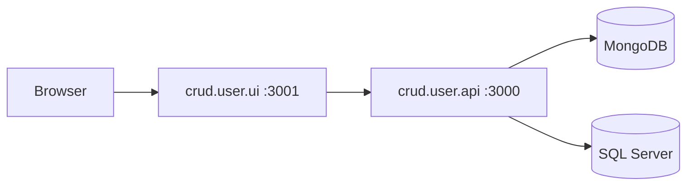

# 🏗️ Crud.Users.Infrastructure
Orchestration repository to run the full **Crud Users** stack with Docker Compose. It coordinates the API (.NET) and UI (Next.js) as containerized services.

## 📦 Project repositories
| Repository | Description | Link |
|------------|-------------|------|
| **Crud.Users.Api** | REST API for user management, JWT authentication, MongoDB and SQL Server | [github.com/agustinafassina/Crud.Users.Api](https://github.com/agustinafassina/Crud.Users.Api) |
| **Crud.Users.Ui** | Next.js web interface for user CRUD operations | [github.com/agustinafassina/Crud.Users.Ui](https://github.com/agustinafassina/Crud.Users.Ui) |
| **Crud.Users.Infrastructure** | Docker Compose to run API + UI together | This repository |

## 🗺️ Architecture


## ✅ Prerequisites
- [Git](https://git-scm.com/)
- [Docker Desktop](https://www.docker.com/products/docker-desktop/) (includes Docker Compose)
- Access to the databases configured in the API (MongoDB and/or SQL Server for the `Testing` environment)

## 📁 Recommended folder structure
Clone all three repositories as sibling folders:

```text
Crud.Users/
├── Crud.Users.Api/
├── Crud.Users.Ui/
└── Crud.Users.Infrastructure/
```

## 🚀 Installation
### 1️⃣ Clone the repositories
From the folder where you want to work (for example `Crud.Users/`):

```bash
git clone https://github.com/agustinafassina/Crud.Users.Api.git
git clone https://github.com/agustinafassina/Crud.Users.Ui.git
git clone https://github.com/agustinafassina/Crud.Users.Infrastructure.git
```

### 2️⃣ Configure the environment
From `Crud.Users.Infrastructure/`, create your local `.env` (it is git-ignored):

```bash
cd Crud.Users.Infrastructure
cp .env.example .env
```

| Variable | Description |
|----------|-------------|
| `SQL_SA_PASSWORD` | SQL Server `sa` password (min 8 chars, upper + lower + digit + symbol) |
| `JWT_SECRET_KEY` | JWT signing key (at least 32 characters) |

### 3️⃣ Build and start the stack
Docker Compose builds the API and UI images from the sibling folders (`../Crud.Users.Api` and `../Crud.Users.Ui`) and starts SQL Server and MongoDB:

```bash
docker compose up -d --build
```

On startup the API applies the EF Core migrations to SQL Server automatically.

To view logs in real time:

```bash
docker compose up
```

## 🌐 Services and ports
| Service | Image | Local port | Environment variable |
|---------|-------|------------|----------------------|
| API | `crud.user.api` | [http://localhost:3000](http://localhost:3000) | `ASPNETCORE_ENVIRONMENT=Testing` |
| UI | `crud.user.ui` | [http://localhost:3001](http://localhost:3001) | `Environment=Testing` |
| SQL Server | `mcr.microsoft.com/mssql/server:2022-latest` | `localhost:1433` | `MSSQL_SA_PASSWORD` |
| MongoDB | `mongo:7` | `localhost:27017` | — |

- API Swagger: [http://localhost:3000/swagger/index.html](http://localhost:3000/swagger/index.html)
- The API waits for SQL Server and MongoDB to be healthy before starting.
- Data is persisted in the `sqlserver-data` and `mongo-data` volumes (`docker compose down -v` deletes it).

## 💻 Useful commands
```bash
# Stop containers
docker compose down

# Check service status
docker compose ps

# View logs
docker compose logs -f

# Rebuild images and start again
docker compose up -d --build

# Rebuild a single service
docker compose up -d --build crud.user.api
```

## 🔄 Development workflow
1. Make changes in **Crud.Users.Api** or **Crud.Users.Ui**.
2. From this repository, rebuild and restart the modified service (`docker compose up -d --build <service>`).
