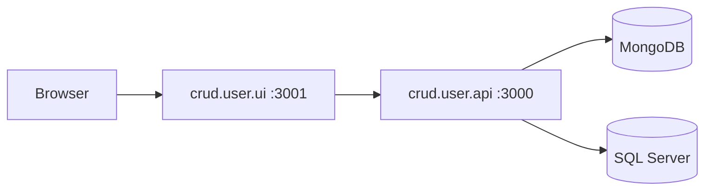

# 🏗️ Crud.Users.Infrastructure
Orchestration repository to run the full **Crud Users** stack with Docker Compose. It coordinates the API (.NET) and UI (Next.js) as containerized services.

## 📦 Project repositories
| Repository | Description | Link |
|------------|-------------|------|
| **Crud.Users.Api** | REST API for user management, JWT authentication, MongoDB and SQL Server | [github.com/agustinafassina/Crud.Users.Api](https://github.com/agustinafassina/Crud.Users.Api) |
| **Crud.Users.Ui** | Next.js web interface for user CRUD operations | [github.com/agustinafassina/Crud.Users.Ui](https://github.com/agustinafassina/Crud.Users.Ui) |
| **Crud.Users.Infrastructure** | Docker Compose to run API + UI together | This repository |

## 🗺️ Architecture


## ✅ Prerequisites
- [Git](https://git-scm.com/)
- [Docker Desktop](https://www.docker.com/products/docker-desktop/) (includes Docker Compose)
- Access to the databases configured in the API (MongoDB and/or SQL Server for the `Testing` environment)

## 📁 Recommended folder structure
Clone all three repositories as sibling folders:

```text
Crud.Users/
├── Crud.Users.Api/
├── Crud.Users.Ui/
└── Crud.Users.Infrastructure/
```

## 🚀 Installation
### 1️⃣ Clone the repositories
From the folder where you want to work (for example `Crud.Users/`):

```bash
git clone https://github.com/agustinafassina/Crud.Users.Api.git
git clone https://github.com/agustinafassina/Crud.Users.Ui.git
git clone https://github.com/agustinafassina/Crud.Users.Infrastructure.git
```

### 2️⃣ Build the Docker images
Docker Compose uses local images with fixed names. Build each service from its own repository **before** starting the stack.

**API** (from `Crud.Users.Api/`):

```bash
cd Crud.Users.Api
docker build -f Dockerfile -t crud.user.api .
```

**UI** (from `Crud.Users.Ui/`):

```bash
cd ../Crud.Users.Ui
docker build -f Dockerfile -t crud.user.ui .
```

> The tags `crud.user.api` and `crud.user.ui` must match exactly those defined in `docker-compose.yml`.

### 3️⃣ Start the stack
From `Crud.Users.Infrastructure/`:

```bash
cd ../Crud.Users.Infrastructure
docker compose up -d
```

To view logs in real time:

```bash
docker compose up
```

## 🌐 Services and ports
| Service | Image | Local port | Environment variable |
|---------|-------|------------|----------------------|
| API | `crud.user.api` | [http://localhost:3000](http://localhost:3000) | `ASPNETCORE_ENVIRONMENT=Testing` |
| UI | `crud.user.ui` | [http://localhost:3001](http://localhost:3001) | `Environment=Testing` |

- API Swagger: [http://localhost:3000/swagger/index.html](http://localhost:3000/swagger/index.html)
- The UI depends on the API (`depends_on: crud.user.api`).

## 💻 Useful commands
```bash
# Stop containers
docker compose down

# Check service status
docker compose ps

# View logs
docker compose logs -f

# Rebuild images and start again
# (run docker build in Api and Ui, then:)
docker compose up -d --force-recreate
```

## 🔄 Development workflow
1. Make changes in **Crud.Users.Api** or **Crud.Users.Ui**.
2. Rebuild the modified service image (`docker build ...`).
3. Restart the stack from this repository (`docker compose up -d --force-recreate`).
